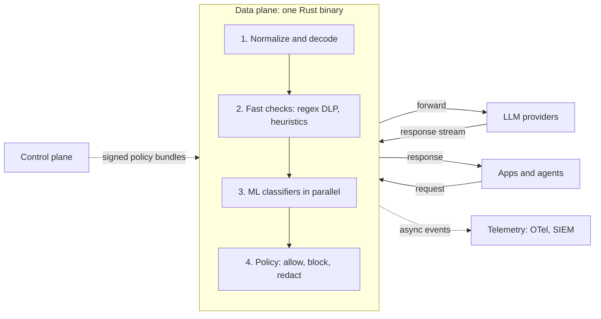

# Architecture

Promptwall puts one compiled data-plane binary on the request path and keeps management and analytics off it. That is what keeps added latency in single-digit milliseconds and deployment down to one file or one container.

## Components

- **Data plane:** a reverse proxy that terminates the client call, runs detectors, and forwards to the provider. Stateless and horizontally scalable; policies and models are held in memory. Detectors run concurrently. The upstream call may start optimistically while slower checks finish and is cancelled if a check fails.
- **Detector engine:** three tiers.
  - Tier 1: compiled multi-pattern regex and heuristics (microseconds).
  - Tier 2: small quantized transformer classifiers on CPU (milliseconds).
  - Tier 3: optional LLM-as-judge or grounding checks, always asynchronous or opt-in per route.
- **Plugins:** custom detectors as WebAssembly modules, so the engine can be extended without forking it.
- **Control plane:** policies, keys and the admin API. Pushes signed policy bundles; data planes keep working if it is unavailable. In the open source edition this is a YAML file on disk.
- **Telemetry:** events batched asynchronously and exported over OpenTelemetry.

## Proposed stack

| Layer | Choice | Why |
| --- | --- | --- |
| Data plane | Rust (Tokio, Hyper; evaluate Pingora) | Predictable latency, no GC pauses, memory safety, one static binary |
| Pattern matching | Vectorscan/Hyperscan, Rust `regex` sets, Aho-Corasick | Thousands of patterns in one pass |
| ML inference | ONNX Runtime, INT8-quantized models under 100M parameters | 12 to 200 ms on CPU today, run in parallel with the provider call ([models](models.md)); under 10 ms is the goal for an in-house distilled model |
| Plugins | WebAssembly (Wasmtime) | Sandboxed, language-agnostic |
| Policy language | YAML plus CEL expressions | Readable and testable |
| npm package | Tier 1 detectors compiled to WebAssembly | Same rules in Node and edge runtimes |
| Model training | Python, PyTorch, Hugging Face, exported to ONNX | Kept out of the runtime |

These are proposals to be confirmed by a spike in Phase 1. A Go data plane is the fallback if Rust slows the team down.

## Latency budget

Added by the firewall, prompts up to 2,000 tokens:

| Stage | p50 target | p95 target |
| --- | --- | --- |
| Proxy overhead (TLS, parse, normalize) | 1 ms | 2 ms |
| Tier 1 fast checks | 0.5 ms | 1 ms |
| Tier 2 ML classifiers (parallel with the provider call, see below) | 0 ms added | 0 ms added |
| Policy decision and redaction | 0.5 ms | 1 ms |
| **Total** | **about 8 ms** | **under 20 ms** |

Tier 2 classifiers do not fit the budget on the request path: open models take 12 to 200 ms on CPU depending on prompt length. They therefore run while the request is already with the provider, and only the response waits for their verdict; a block cancels the provider call. Providers take hundreds of milliseconds to the first token, so the classifier usually adds nothing. Routes can opt out with `parallel: false` ([models](models.md)).

How it stays there: parallel detectors with per-detector timeouts, verdict caching for repeated system prompts and documents, scanning only new turns in a conversation, chunked inspection of streamed output, and shadow (async) mode for any detector that misses its budget. The [benchmark spec](specs/benchmark.md) defines how these numbers are measured and enforced in CI.

## Deployment modes

- **Proxy:** `docker run` or a single binary plus a YAML policy file; Helm chart for Kubernetes. Apps change their base URL.
- **Embedded (npm):** a wrapper around the existing model call. Tier 1 checks run in-process as WebAssembly in Node, Vercel or Supabase Edge Functions and Cloudflare Workers. Tier 2 checks call a Promptwall proxy (self-hosted or hosted) with an API key. If it is unreachable the package falls back to Tier 1, configurable as fail-open or fail-closed.
